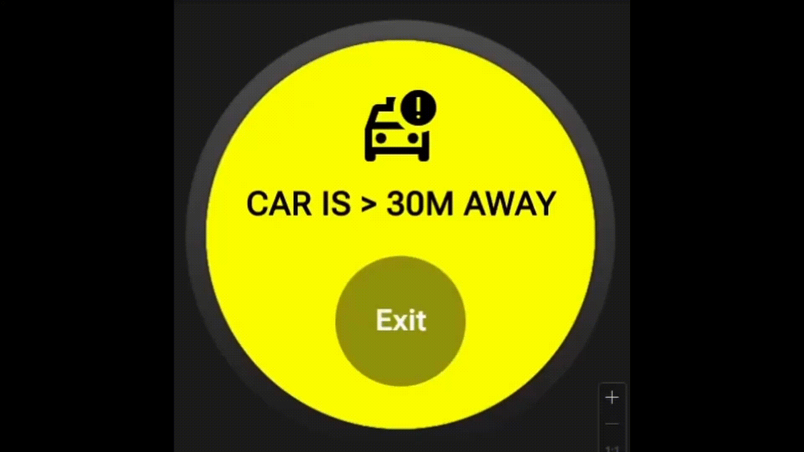

# SafeStride: Real-Time Crosswalk Safety for Visually Impaired Pedestrians



At crossings without traffic lights, visually impaired pedestrians cannot see whether an approaching car is slowing down or about to stop, and quiet electric cars make this even harder to hear.

**SafeStride** watches the road with a camera, detects approaching vehicles in real time with YOLOv11, and turns the danger level into vibration patterns on a **Wear OS smartwatch** and a **smart cane**. When it is safe to cross, the devices go silent.

Built at the University of Amsterdam (2026) and field-tested at a real street crossing in Amsterdam.

**Demo video:** [watch SafeStride in action on YouTube](https://www.youtube.com/watch?v=aEHTeOglvig)

<br clear="right"/>

## How it works

```text
USB camera ─▶ Raspberry Pi ──(ZeroMQ, JPEG frames, port 5555)──▶ Laptop
                                                                 │  YOLOv11 vehicle detection
                                                                 │  + calibrated distance zones
                                                                 ▼
              Raspberry Pi relay ◀──(UDP danger status, port 9001)┘
                     │
                     ├──(UDP, port 9000)──▶ Wear OS smartwatch app (Kotlin)
                     └──(UDP, port 9002)──▶ Smart cane, Arduino Nano 33 IoT (C++)
```

1. **Capture.** The Raspberry Pi grabs frames from a USB camera through a GStreamer pipeline, compresses them to JPEG and publishes them over ZeroMQ.
2. **Detect.** The laptop subscribes to the stream and runs YOLOv11n on cars, motorcycles, buses and trucks. Before starting, the operator draws three zones on the live image (red, orange and yellow), which map to distance from the crossing.
3. **Decide.** Each frame produces one danger status for the closest vehicle, which is sent back to the Pi over UDP. During the field test, the laptop and the Pi were connected over Tailscale.
4. **Alert.** The Pi relays the status over UDP to the watch and the cane, which each play the matching vibration pattern.

## Danger levels

| Status | Meaning | Vibration (watch and cane) |
|---|---|---|
| `> 30M AWAY` | Vehicle in the far (yellow) zone | Slow single ping: 200 ms on, 2 s off |
| `15-30M AWAY` | Vehicle in the middle (orange) zone | Double tap: 200 on, 200 off, 200 on, 800 off |
| `< 15M AWAY` | Vehicle in the near (red) zone | Fast emergency pulse: 200 ms on, 50 ms off |
| `STOPPED OR GONE` | No approaching vehicle | **Silence** |

## Design decisions

- **Silence means safe.** We first planned a "green light" vibration, but constant buzzing causes tactile fatigue in an already stressful situation. Instead, the absence of vibration signals that it is safe to cross.
- **Never signal "safe" by mistake.** A false "safe" is far more dangerous than a short delay, so the system filters out detection glitches:
  - `tester_brain.py` tracks each vehicle and checks whether its bounding box is still growing (approaching). A vehicle in the red zone only counts as stopped after **15 consecutive frames** without growth.
  - The cane holds the last danger state for **1.5 seconds** before accepting a "safe" message, so one dropped detection cannot silence it.
- **Heavy work off the edge device.** The Pi only captures and relays. The laptop runs detection, which keeps latency low on cheap hardware.

## Project structure

```text
UvA-Safe-Crosswalk/
├── camera_pi/                   # Runs on the Raspberry Pi (Python)
│   ├── camera_stream.py         # Captures camera frames and publishes them over ZeroMQ
│   ├── field_test_udp_relay.py  # Relays the danger status to the watch (field test)
│   └── watch_cane_test.py       # Relays the danger status to the watch and the cane
├── processing/                  # Runs on the laptop (Python)
│   ├── field_test_demo_brain.py # Live stream + zone calibration + YOLO + UDP alerts (field test)
│   ├── tester_brain.py          # Same, with vehicle tracking and the 15-frame stop buffer
│   ├── demo_brain.py            # Offline demo on recorded video
│   ├── receive_stream.py        # Minimal stream viewer
│   └── detector.py              # YOLO detection wrapper
├── safestride-app/              # Wear OS app (Kotlin, Jetpack Compose)
│   └── app/src/main/java/com/example/safestride/presentation/
│       ├── SafeStrideService.kt     # Foreground service listening for UDP packets
│       ├── crosswalk-haptics.kt     # Maps each status to a vibration pattern
│       └── MainActivity.kt          # Watch UI showing the current status
├── wearable_nano33/             # Smart cane firmware (C++, PlatformIO)
│   ├── src/main.cpp             # Wi-Fi, UDP listener, glitch filter, motor patterns
│   └── include/secrets.example.h
└── .github/workflows/android.yml  # CI: builds the Wear OS app on every push
```

## Running it

**Requirements:** a Raspberry Pi with a USB camera, a laptop (a GPU is optional but helps), a Wear OS watch and/or the smart cane, all on the same network (or connected through Tailscale).

```bash
pip install opencv-python pyzmq python-dotenv ultralytics numpy torch
```

1. **Configure.** Copy `.env.example` to `.env` and set `PI_IP` and `ZMQ_PORT`. The relay scripts contain the watch and cane IP addresses, so update those to match your network.
2. **Camera (on the Pi):** `python3 camera_pi/camera_stream.py`
3. **Relay (on the Pi):** `python3 camera_pi/watch_cane_test.py`
4. **Detection (on the laptop):** `python processing/field_test_demo_brain.py`. Click four points for each zone (red, orange, yellow), then press Enter.
5. **Watch:** open `safestride-app` in Android Studio, install it on the watch and start monitoring. The app listens on UDP port 9000.
6. **Cane:** copy `wearable_nano33/include/secrets.example.h` to `secrets.h`, add your Wi-Fi details, and flash it with PlatformIO. Press the button to activate the motor.

## Limitations

- The prototype watches one direction of traffic. A real deployment needs a camera per direction and logic that combines them.
- The camera was mounted low on a bus stop, so lamp posts sometimes hid passing cars. A pole-mounted camera with an edge accelerator (TPU) would fix both height and latency.
- Thresholds and vibration patterns should be tuned together with visually impaired users.

## Team

Developed at the University of Amsterdam by:
* **Marieke Elzer**
* **Soufiane el Ouaâzizi**
* **Stijn Nagtzaam**
* **Giang Nguyen** (technical lead)
* **Dimitris Thomopoulos**
